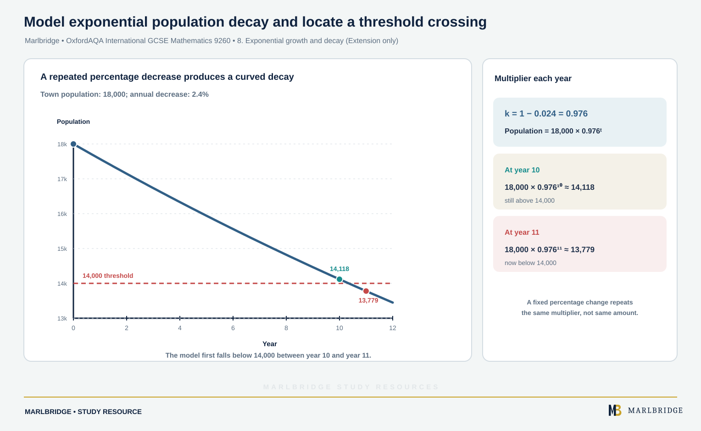

This study guide is aligned to the OxfordAQA International GCSE Mathematics (9260) specification, Version 5.1, for exams from May/June 2018 onwards. It covers N15 in section 3.1.2 (percentage change, interest, reverse percentages and the compound interest formula) and the repeated proportional change and exponential growth and decay statements of N20 in section 3.1.3. N15 and the repeated proportional change in N20 are Core content, so they can be assessed at both tiers. Reverse percentages, the compound interest formula and exponential growth and decay are marked **Extension only** below.

Use it with the [revision notes](/resources/oxfordaqa-igcse-mathematics-percentage-change-interest-and-exponential-growth-and-revision-notes/) and the [practice questions](/resources/oxfordaqa-igcse-mathematics-percentage-change-interest-and-exponential-growth-and-practice/). The wider [Number study guide](/resources/igcse-oxfordaqa-mathematics-number/) covers the rest of the strand. Check where you stand with the [free diagnostics](/diagnostics/), and tick off progress on the [course checklist](/checklists/oxfordaqa/igcse/mathematics/). The course hub is at [/boards/oxfordaqa/igcse/mathematics/](/boards/oxfordaqa/igcse/mathematics/).

## What this unit covers

| Spec | What you must be able to do | Tier |
|---|---|---|
| N15 | Solve problems involving percentage increase and decrease | Core |
| N15 | Solve problems involving simple interest and compound interest | Core |
| N15 | Solve reverse percentage problems | Extension only |
| N15 | Use the compound interest formula P(1 + r/100)ⁿ | Extension only |
| N20 | Solve problems involving repeated proportional change | Core |
| N20 | Solve problems on exponential growth and decay | Extension only |

Direct and inverse proportion, also in N20, belong to a separate unit.

## 1. The multiplier method

A percentage change is a multiplication. Write the new amount as a percentage of the old amount, then turn it into a decimal.

| Change | New amount is | Multiplier |
|---|---|---|
| Increase by 12% | 112% of the old | 1.12 |
| Decrease by 12% | 88% of the old | 0.88 |
| Increase by 3.5% | 103.5% of the old | 1.035 |
| Decrease by 0.5% | 99.5% of the old | 0.995 |

Increase: multiplier = 1 + r/100. Decrease: multiplier = 1 − r/100.

**Worked example 1.** A laptop costs £845. A shop takes 12% off. Find the sale price.

```
Multiplier for a 12% decrease = 1 − 0.12 = 0.88
Sale price = 845 × 0.88 = £743.60
```

Working out 12% and subtracting also works. The multiplier is quicker, and you will need it for the later sections.

<figure class="topic-figure">
  
  <figcaption>A percentage change is a single multiplication: increase 20% is x 1.2, decrease 20% is x 0.8.</figcaption>
</figure>


## 2. Percentage change

Percentage change = (change ÷ original) × 100. The original is always the amount you started with, not the larger or smaller of the two.

**Worked example 2.** A flat's rent rises from £540 to £603 a month. Find the percentage increase.

```
Change = 603 − 540 = 63
Percentage change = 63/540 × 100 = 11.67...
```

The increase is **11.7%** (3 s.f.).

**Worked example 3.** A tank holds 64 litres. After a leak it holds 52 litres. Find the percentage decrease.

```
Change = 64 − 52 = 12
12/64 × 100 = 18.75
```

The decrease is **18.75%**, or 18.8% to 3 s.f. Say "decrease" in your answer, because the question asks for the direction as well as the size.

<figure class="topic-figure">
  
  <figcaption>Divide the change by the original amount, not the new one.</figcaption>
</figure>


## 3. Simple interest

With simple interest, only the sum you first invested earns anything, so each year adds an identical amount.

Simple interest = P × r/100 × t, where P is the sum invested, r is the yearly rate (%) and t is the time in years.

**Worked example 4.** Find the simple interest on £2,400 invested for 4 years at 3.5% a year, and the total at the end.

```
Interest = 2400 × 0.035 × 4 = £336
Total = 2400 + 336 = £2,736
```

**Worked example 5.** £1,800 earns £198 simple interest in 2.5 years. Find the yearly rate.

```
198 = 1800 × (r/100) × 2.5
198 = 45r
r = 4.4
```

The rate is **4.4%** a year.

<figure class="topic-figure">
  
  <figcaption>Simple interest adds the same slice every year.</figcaption>
</figure>


## 4. Compound interest (Core: repeated multipliers)

Compound interest is paid on the original sum plus the interest already earned. Each year the balance is multiplied by the same multiplier, so you multiply once per year.

**Worked example 6.** £3,200 earns 2.5% compound interest a year for 3 years. Find the final amount and the total interest.

```
Multiplier = 1.025
After year 1: 3200 × 1.025 = 3280
After year 2: 3280 × 1.025 = 3362
After year 3: 3362 × 1.025 = 3446.05
Interest = 3446.05 − 3200 = £246.05
```

If the rate changes from year to year, multiply by a different number each time.

**Worked example 7.** £5,000 earns 3% in year 1, 2.5% in year 2 and 1.8% in year 3.

```
5000 × 1.03 × 1.025 × 1.018 = £5,373.77 (nearest penny)
```

For Core questions, show the multiplier for every year. A single number with no working gives nothing to follow if it is wrong.

<figure class="topic-figure">
  
  <figcaption>Compound interest adds interest on earlier interest, so each year earns a little more.</figcaption>
</figure>


## 5. Compound interest formula (Extension only)

For a fixed rate, the repeated multiplication shortens to a formula.

Value of investment = P(1 + r/100)ⁿ

Here P is the amount invested, r is the percentage rate of interest and n is the number of years of compound interest.

**Worked example 8.** Find the value of £7,500 invested for 6 years at 3.2% compound interest.

```
Value = 7500 × (1 + 3.2/100)⁶
      = 7500 × 1.032⁶
      = £9,060.23
```

To find the **rate**, divide the final amount by P, then take the nth root.

**Worked example 9.** £7,000 grows to £9,005 in 4 years at a fixed compound rate. Find the rate.

```
7000 × (1 + r/100)⁴ = 9005
(1 + r/100)⁴ = 9005/7000 = 1.28643
1 + r/100 = 1.28643^(1/4) = 1.06499...
r = 6.5
```

The rate is **6.5%** a year.

<figure class="topic-figure">
  
  <figcaption>Each year multiplies by 1.032, so n years multiplies n times.</figcaption>
</figure>

<figure class="topic-figure">
  
  <figcaption>To find the rate, divide by P then take the n-th root.</figcaption>
</figure>


## 6. Reverse percentages (Extension only)

In a reverse percentage problem you are given the amount after the change and must find the original. Divide by the multiplier. Do not take a percentage of the new amount.

**Worked example 10.** After a 15% increase, a monthly fee is £1,380. Find the fee before the increase.

```
Multiplier = 1.15
Original × 1.15 = 1380
Original = 1380 ÷ 1.15 = £1,200
```

**Worked example 11.** A coat is reduced by 20% in a sale. The sale price is £68. Find the original price.

```
Sale price is 80% of the original, so multiplier = 0.8
Original = 68 ÷ 0.8 = £85
```

Check by working forwards: 85 × 0.8 = 68.

<figure class="topic-figure">
  
  <figcaption>To undo a percentage change, divide by its multiplier.</figcaption>
</figure>


## 7. Repeated proportional change (Core)

When a quantity changes by one percentage and then by another, multiply the multipliers. Do not add the percentages.

**Worked example 12.** A price rises by 5% and then falls by 4%. Find the overall percentage change.

```
Overall multiplier = 1.05 × 0.96 = 1.008
```

The price rises by **0.8%** overall, not 1%. The 4% fall is taken from the new, higher price.

<figure class="topic-figure">
  
  <figcaption>Multiply the multipliers; do not add the percentages.</figcaption>
</figure>


## 8. Exponential growth and decay (Extension only)

<!-- marlbridge-diagram:math-b56-oxfordaqa-exponential-population-decay -->
<figure class="lesson-diagram" style="margin: 2rem 0;">
  <a href="/public/images/learning/mathematics/math-b56-oxfordaqa-exponential-population-decay.svg" aria-label="Open full-size diagram: math-b56-oxfordaqa-exponential-population-decay"></a>
  <figcaption>A decreasing exponential curve for P=18000×0.976^t starts at 18,000. It is above the dashed 14,000 threshold at year 10 (14,118) and below at year 11 (13,779).</figcaption>
</figure>
<!-- /marlbridge-diagram:math-b56-oxfordaqa-exponential-population-decay -->


Repeated proportional change with the same multiplier k each time gives a model of the form

amount after t steps = starting amount × kᵗ

If k > 1 you have exponential **growth**. If 0 < k < 1 you have exponential **decay**. The interest formula in section 5 is an example with k = 1 + r/100.

**Worked example 13.** A town has 18,000 people. The population falls by 2.4% a year.

```
k = 1 − 0.024 = 0.976
Population after t years = 18000 × 0.976ᵗ
t = 10: 18000 × 0.976¹⁰ = 14,118 (nearest whole number)
```

To find when the population first falls below 14,000, try values of t:

```
t = 10: 14,118   (still above 14,000)
t = 11: 13,779   (below)
```

It falls below 14,000 during the **11th year**.

**Worked example 14.** A van is worth £21,500 and loses 14% of its value each year. In which year does it first fall below half its value?

```
Half of 21,500 = 10,750
Value after t years = 21500 × 0.86ᵗ
t = 4: 11,760.68
t = 5: 10,114.18
```

The value first falls below £10,750 after **5 years**.

<figure class="topic-figure">
  
  <figcaption>Test consecutive values of t to find where the target is first passed.</figcaption>
</figure>

<figure class="topic-figure">
  
  <figcaption>Exponential growth pulls ahead of linear growth because each year's percentage is taken of a larger value.</figcaption>
</figure>

<figure class="topic-figure">
  
  <figcaption>Show the years either side of the target to prove which year first passes it.</figcaption>
</figure>


## A quick way to choose a method

Read the wording before you reach for a formula.

- If the question gives the old and new amounts and asks for a percentage, use change ÷ original.
- If it gives the original and a percentage, multiply by the multiplier.
- If it gives the final amount and a percentage, and asks for the start, divide by the multiplier (Extension only).
- If the same percentage is applied over and over, the power form kᵗ is the shortest route (Extension only). At Core, multiply year by year.

## Common errors

- Dividing by the new amount when finding a percentage change. Divide by the original.
- Adding percentages in repeated change. A 20% rise followed by a 20% fall is not "no change"; the multiplier is 1.2 × 0.8 = 0.96.
- Using the simple interest method when the question says compound, or the reverse.
- Reverse percentages: finding 15% of £1,380 and subtracting. The 15% was taken from the original, not from £1,380.
- Using the wrong power in the formula. If interest is paid for 3 years, n = 3, not 4.
- Rounding too soon. Keep the full unrounded value and round money to the nearest penny only at the end.
- Writing 1.5 as the multiplier for a 5% rise. A 5% rise is 1.05.

## Next steps

Work through the [practice questions](/resources/oxfordaqa-igcse-mathematics-percentage-change-interest-and-exponential-growth-and-practice/), then condense your notes using the [revision notes](/resources/oxfordaqa-igcse-mathematics-percentage-change-interest-and-exponential-growth-and-revision-notes/). The [Number practice set](/resources/igcse-oxfordaqa-mathematics-number-practice/) tests the rest of the strand.

## Frequently asked questions

**What is a multiplier in percentages?**
A multiplier is the decimal you multiply by to apply a percentage change. An increase of 12% is a multiplier of 1.12 and a decrease of 12% is 0.88.

**What is the formula for exponential growth and decay?**
Amount = start × kᵗ, where k = 1 + r/100 for growth and k = 1 − r/100 for decay. Growth has k above 1 and decay has k between 0 and 1.

**Which references cover percentages and interest in OxfordAQA 9260?**
In OxfordAQA International GCSE Mathematics (9260), N15 covers percentage change, simple and compound interest and reverse percentages, and N20 covers repeated proportional change and exponential growth and decay.

**How do you choose the right percentage method?**
If you have old and new amounts, use change ÷ original. If you have the original and a percentage, multiply by the multiplier. If you have the final amount and need the start, divide by the multiplier.

## Official syllabus

OxfordAQA International GCSE Mathematics (9260), Version 5.1, for exams May/June 2018 onwards, published by OxfordAQA. Spec references: N15 (3.1.2) and N20 (3.1.3).
