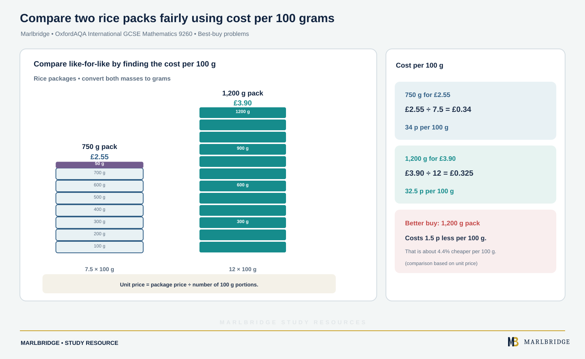

This guide covers section 3.1.3 (Ratio and proportion) in the OxfordAQA International GCSE Mathematics specification (9260), Version 5.1, for exams in May/June 2018 onwards. It teaches statements N16 to N20. All of it is Core content, and the specification states that Core content can also be assessed on the Extension papers. The Extension-only part of N20, exponential growth and decay, is taught elsewhere.

Related pages: [revision notes](/resources/oxfordaqa-igcse-mathematics-ratio-rates-best-buys-and-direct-and-inverse-proportion-revision-notes/), [practice questions](/resources/oxfordaqa-igcse-mathematics-ratio-rates-best-buys-and-direct-and-inverse-proportion-practice/), the [OxfordAQA IGCSE Mathematics hub](/boards/oxfordaqa/igcse/mathematics/), the [printable checklist](/checklists/oxfordaqa/igcse/mathematics/) and the [free diagnostics](/diagnostics/). For earlier number work, see the [Number study guide](/resources/igcse-oxfordaqa-mathematics-number/).

## What this unit covers

| Ref | What you must be able to do | Level |
|---|---|---|
| N16 | Use ratio notation, reduce a ratio to simplest form, link ratios to fractions | Core |
| N17 | Divide a quantity in a given ratio | Core |
| N18 | Apply ratio to solve problems | Core |
| N19 | Use common measures of rate, including rates of pay and best-buy problems | Core |
| N20 | Solve problems involving direct and inverse proportion, including repeated proportional change | Core |

## N16: ratio notation and simplest form

A ratio compares quantities of the same kind. Write "3 to 5" as 3 : 5. The order matters: the ratio of boys to girls is not the ratio of girls to boys.

Multiplying or dividing every part by the same non-zero number gives an equivalent ratio. A ratio is in simplest form when its parts are whole numbers with no common factor.

Three habits stop most mistakes:

1. Put all parts in the same unit before you simplify.
2. Clear decimals and fractions by multiplying every part by the same number.
3. Do not put units in the final ratio. The ratio 4 : 3 has no unit.

**Worked example 1.** Write 0.6 kg : 450 g in simplest form.

```
0.6 kg = 600 g
600 : 450
divide both by 150
4 : 3
```

**Worked example 2.** Simplify 2/3 : 5/6.

```
common denominator is 6, so multiply both parts by 6
(2/3 × 6) : (5/6 × 6) = 4 : 5
```

Sometimes you are asked for the form 1 : n, where n may be a decimal or fraction. Divide both parts by the first. For 8 : 20, divide by 8 to get 1 : 2.5.

### Links to fractions

A ratio of parts gives fractions of the whole. If red beads to blue beads is 3 : 7, there are 3 + 7 = 10 equal parts in total. Red beads are 3/10 of the whole and blue are 7/10. The ratio of red to blue is 3 : 7, but the fraction that are red is 3/10, not 3/7. This difference is one of the most common errors in the topic.

Going the other way, if 2/5 of a club are juniors, then 3/5 are not, so juniors to others is 2 : 3.

<figure class="topic-figure">
  
  <figcaption>A ratio compares part with part; a fraction compares part with the whole.</figcaption>
</figure>

<figure class="topic-figure">
  
  <figcaption>Convert to the same unit, then divide both parts by the highest common factor: 600 : 450 = 4 : 3.</figcaption>
</figure>


## N17: dividing a quantity in a given ratio

The method never changes:

1. Add up the parts of the ratio.
2. Work out what one part is worth: the quantity ÷ that sum.
3. Multiply one part by each number in the ratio.
4. Add the shares back together to check them against the original quantity.

**Worked example 3.** Divide 520 in the ratio 3 : 4 : 6.

```
parts: 3 + 4 + 6 = 13
one part: 520 ÷ 13 = 40
shares: 3 × 40 = 120, 4 × 40 = 160, 6 × 40 = 240
check: 120 + 160 + 240 = 520
```

### When one share is known

Sometimes the total is missing. Instead you know one share, or how far apart two shares are. Work out what one part is worth before anything else.

**Worked example 4.** Anya and Ben share money in the ratio 5 : 8. Ben gets 136. How much does Anya get, and what was the total?

```
8 parts = 136, so 1 part = 136 ÷ 8 = 17
Anya: 5 × 17 = 85
total: 13 × 17 = 221
```

**Worked example 5.** Two shares are in the ratio 4 : 7 and differ by 54. Find the total.

```
difference in parts: 7 - 4 = 3 parts
3 parts = 54, so 1 part = 18
total parts: 4 + 7 = 11
total: 11 × 18 = 198
```

<figure class="topic-figure">
  
  <figcaption>When the total is missing, use the known share or the difference to find the value of one part.</figcaption>
</figure>

<figure class="topic-figure">
  
  <figcaption>Add the parts, divide the total by that number, then multiply by each share.</figcaption>
</figure>


## N18: applying ratio to problems

Problems in this section combine the methods above. Four types come up again and again.

### Combining two ratios

When two ratios share a middle term, make that term equal in both. If A : B = 3 : 4 and B : C = 6 : 5, then B must be 12 in both. Multiply the first by 3 and the second by 2:

```
A : B = 9 : 12
B : C = 12 : 10
A : B : C = 9 : 12 : 10
```

**Worked example 6.** In a choir, sopranos to altos is 5 : 6 and altos to tenors is 4 : 3. There are 279 singers in all. How many are tenors?

```
altos: LCM of 6 and 4 is 12
sopranos : altos = 10 : 12, altos : tenors = 12 : 9
sopranos : altos : tenors = 10 : 12 : 9
parts: 10 + 12 + 9 = 31
one part: 279 ÷ 31 = 9
tenors: 9 × 9 = 81
```

<figure class="topic-figure">
  
  <figcaption>Make the shared term equal, then join the ratios.</figcaption>
</figure>


### Changing quantities

When something is added or removed, the ratio changes but one quantity may stay fixed. Write the original amounts as multiples of the ratio, for example 5k and 3k, then form an equation from the new situation.

**Worked example 7.** Gold and silver stickers are in the ratio 7 : 4. After 15 more silver stickers are added, the numbers of gold and silver are equal. How many stickers were there at first?

```
start: 7k gold, 4k silver
after: 7k gold, 4k + 15 silver
equal: 7k = 4k + 15
3k = 15, so k = 5
start: 35 gold and 20 silver, 55 stickers in all
check: 35 and 20 + 15 = 35
```

<figure class="topic-figure">
  
  <figcaption>The 15 stickers added fill the gap of 3 parts, so one part is 5.</figcaption>
</figure>


### Scaling a recipe or mixture

If a ratio describes a mixture, scale every part by the same factor. A mix of 2 parts concentrate to 7 parts water makes 9 parts of drink. To make 90 litres you need 90 ÷ 9 = 10 litres per part, so 20 litres of concentrate and 70 litres of water.

### Fraction and ratio together

Use the fraction link from N16 to move between "fraction of the whole" and "ratio of parts". If 3/8 of a class walk to school, the others are 5/8, so walkers to others is 3 : 5.

## N19: rates, rates of pay and best buys

A rate compares two different kinds of quantity, so it does carry units. Common rates include:

- speed, in km/h or m/s, found as distance ÷ time
- density, in g/cm³, found as mass ÷ volume
- rate of pay, in money per hour
- price per unit, such as money per kilogram or per litre
- exchange rates, such as dollars per euro

**Worked example 8.** A cyclist rides 150 km in 1 hour 45 minutes. Find the average speed.

```
1 h 45 min = 1.75 h
speed = 150 ÷ 1.75 = 85.714...
average speed = 85.7 km/h (3 significant figures)
```

Convert minutes to hours by dividing by 60 before you divide. Writing 1.45 for 1 h 45 min is a frequent slip.

**Worked example 9 (currency).** Suppose 1 euro = 1.08 dollars. Convert 270 dollars to euros.

```
270 ÷ 1.08 = 250 euros
```

Dollars to euros means fewer euros, so you divide. If your answer has grown, check which way you converted.

### Rates of pay

Basic pay is hours × hourly rate. Overtime is usually paid at a multiple of the basic rate, such as "time and a half", which means 1.5 times the rate.

**Worked example 10.** Hana earns 12.40 an hour for 35 hours. She then works 8 hours overtime at time and a half. Find her total pay.

```
basic: 35 × 12.40 = 434.00
overtime rate: 1.5 × 12.40 = 18.60
overtime: 8 × 18.60 = 148.80
total: 434.00 + 148.80 = 582.80
```

### Best-buy problems

<!-- marlbridge-diagram:math-b56-oxfordaqa-rice-best-buy-unit-price -->
<figure class="lesson-diagram" style="margin: 2rem 0;">
  <a href="/public/images/learning/mathematics/math-b56-oxfordaqa-rice-best-buy-unit-price.svg" aria-label="Open full-size diagram: math-b56-oxfordaqa-rice-best-buy-unit-price"></a>
  <figcaption>Two rice packs are shown in 100 g units: 750 g for £2.55 costs 34 p per100 g; 1,200 g for £3.90 costs 32.5 p per100g, so the larger pack is cheaper per unit.</figcaption>
</figure>
<!-- /marlbridge-diagram:math-b56-oxfordaqa-rice-best-buy-unit-price -->


A best buy gives the lowest cost per unit, or equivalently the most quantity per unit of money. Pick one comparison and use it for every option. Convert to the same unit first.

**Worked example 11.** Rice is sold as 750 g for 2.55 or 1.2 kg for 3.90. Which is the better buy?

```
1.2 kg = 1200 g
cost per 100 g: 2.55 ÷ 7.5 = 0.34 and 3.90 ÷ 12 = 0.325
```

The 1.2 kg bag costs less per 100 g, so it is the better buy. Write the conclusion in words.

**Worked example 12.** A 400 ml bottle of shampoo carries the label "25% extra free" and costs 3.50. A plain 500 ml bottle costs 4.00. Which gives more for the money?

```
extra: 400 × 1.25 = 500 ml for 3.50
amount per unit of money: 500 ÷ 3.50 = 142.9 ml and 500 ÷ 4.00 = 125 ml
```

The offer bottle is the better buy. The cheapest total price is not always the better buy, so compare per unit.

<figure class="topic-figure">
  
  <figcaption>Compare cost per 100 g, not total price.</figcaption>
</figure>

<figure class="topic-figure">
  
  <figcaption>25% extra free turns 400 ml into 500 ml, so compare 500 ml for 3.50 with 500 ml for 4.00.</figcaption>
</figure>

<figure class="topic-figure">
  
  <figcaption>Minutes and decimal hours are different scales, so convert by dividing or multiplying by 60.</figcaption>
</figure>


## N20: direct and inverse proportion

Quantities are directly proportional when doubling one also doubles the other. Their ratio stays constant, and the graph is a straight line through the origin. They are inversely proportional when doubling one halves the other. Their product stays constant, and the graph is a curve that falls and never touches either axis.

### Direct proportion: unitary method

Find the value of one unit, then scale.

**Worked example 13.** 7 notebooks cost 10.50. Find the cost of 12.

```
1 notebook: 10.50 ÷ 7 = 1.50
12 notebooks: 12 × 1.50 = 18.00
```

### Inverse proportion: total amount of work

Find the constant product, then divide.

**Worked example 14.** 6 workers take 15 days to finish a job. How long would 9 workers take, at the same rate?

```
total work: 6 × 15 = 90 worker-days
9 workers: 90 ÷ 9 = 10 days
```

**Worked example 15.** 3 pumps fill a tank in 8 hours. How long do 5 pumps take?

```
3 × 8 = 24 pump-hours
24 ÷ 5 = 4.8 hours = 4 hours 48 minutes
```

### Testing from a table

To test for direct proportion, check whether y ÷ x is the same for every pair. To test for inverse proportion, check whether x × y is the same.

```
x:  2     5     8       y ÷ x: 3.5, 3.5, 3.5   direct
y:  7     17.5  28

x:  3     6     9       x × y: 36, 36, 36      inverse
y:  12    6     4
```

State the constant and the word "direct" or "inverse" in your answer.

<figure class="topic-figure">
  
  <figcaption>Divide for direct proportion, multiply for inverse.</figcaption>
</figure>


### Repeated proportional change

N20 also mentions repeated proportional change. Turn each percentage change into a multiplier and multiply them. A fall of 8% has multiplier 0.92 and a rise of 5% has multiplier 1.05.

**Worked example 16.** A price of 250 falls by 8%, then rises by 5%. Find the final price and the overall percentage change.

```
0.92 × 1.05 = 0.966
final price: 250 × 0.966 = 241.50
overall: 0.966 means a 3.4% fall
```

The overall change is not "-8% + 5% = -3%". Percentages of different amounts cannot be added. Compound interest and growth and decay are covered on other pages.

<figure class="topic-figure">
  
  <figcaption>Multiply the multipliers; percentages of different amounts cannot be added.</figcaption>
</figure>

<figure class="topic-figure">
  
  <figcaption>Direct proportion: y ÷ x is constant and the graph is a straight line through the origin. Inverse: x × y is constant and the graph is a falling curve.</figcaption>
</figure>

<figure class="topic-figure">
  
  <figcaption>In inverse proportion x times y stays constant, so doubling x halves y.</figcaption>
</figure>

<figure class="topic-figure">
  
  <figcaption>A percentage change is a single multiplication: increase 20% is x 1.2, decrease 20% is x 0.8.</figcaption>
</figure>


## Common errors

- Simplifying before converting units, for example 0.6 kg : 450 g treated as 6 : 45.
- Writing 3/7 as the fraction for a 3 : 7 ratio. The fractions are 3/10 and 7/10.
- Dividing 520 by the number of shares (3) instead of by the total number of parts (13).
- Calling a saving "better value" without comparing per unit.
- Treating inverse proportion as direct, so that more workers take more time.
- Adding percentage changes instead of multiplying the multipliers.
- Stopping at a decimal such as 4.8 hours without converting to hours and minutes when asked.

## Next steps

Condense this with the [revision notes](/resources/oxfordaqa-igcse-mathematics-ratio-rates-best-buys-and-direct-and-inverse-proportion-revision-notes/), then try the [practice questions](/resources/oxfordaqa-igcse-mathematics-ratio-rates-best-buys-and-direct-and-inverse-proportion-practice/). Tick off the topic on the [checklist](/checklists/oxfordaqa/igcse/mathematics/) and run a [free diagnostic](/diagnostics/) to find weak spots.

## Frequently asked questions

**Does the order of a ratio matter?**
Yes. The ratio of boys to girls is not the ratio of girls to boys, so write the parts in the order the question gives.

**How do you combine two ratios?**
Scale both ratios so the shared term has the same number, then read off the combined ratio. For example, A : B = 2 : 3 and B : C = 4 : 5 become 8 : 12 and 12 : 15, so A : B : C = 8 : 12 : 15.

**What does direct proportion look like on a graph?**
A straight line through the origin, because the ratio of the two quantities stays constant. Inverse proportion gives a curve falling towards the axes.

**Which references does ratio and proportion cover in OxfordAQA 9260?**
In OxfordAQA International GCSE Mathematics (9260), N16 to N19 cover ratio notation, dividing in a ratio, ratio problems and rates including best buys, and N20 covers direct and inverse proportion and repeated proportional change.

## Official syllabus

OxfordAQA International GCSE Mathematics (9260), Version 5.1, for exams in May/June 2018 onwards, published by OxfordAQA. Section 3.1.3, Ratio and proportion, statements N16 to N20.
