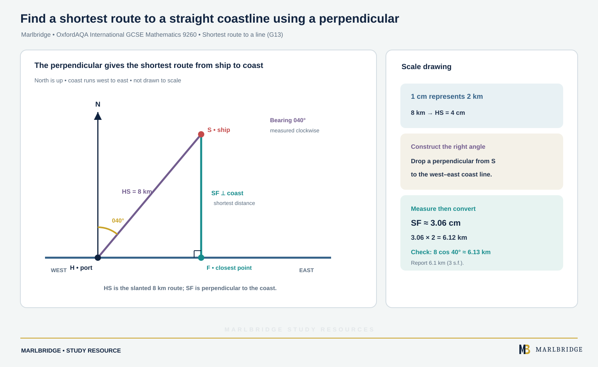

This guide teaches scale drawings, bearings, ruler-and-compass constructions and loci for OxfordAQA International GCSE Mathematics. It follows the OxfordAQA International GCSE Mathematics (9260) specification, Version 5.1 (for exams May/June 2018 onwards), references G12 and G13 in section 3.3.1. Both references are Core content, and the specification states that Core content can also be assessed on the Extension papers, so everything here is for both tiers. There is no Extension-only content in this unit.

Short-form recall is in the [revision notes](/resources/oxfordaqa-igcse-mathematics-scale-drawings-bearings-constructions-and-loci-revision-notes/) and exam-style questions are in the [practice set](/resources/oxfordaqa-igcse-mathematics-scale-drawings-bearings-constructions-and-loci-practice/). Use the [course hub](/boards/oxfordaqa/igcse/mathematics/) and the [printable checklist](/checklists/oxfordaqa/igcse/mathematics/) to track what you have covered. To find your weak spots first, take the [free 10-minute diagnostics](/diagnostics/).

## Scope of this unit

| Reference | Skill | Tier |
|---|---|---|
| G12 | Measure line segments and angles in geometric figures | Core (also Extension) |
| G12 | Interpret maps and scale drawings and use scale factors | Core (also Extension) |
| G12 | Use bearings, including the eight compass points and three-figure bearings | Core (also Extension) |
| G13 | Use the standard ruler-and-compass constructions: perpendicular bisector of a line segment, perpendicular to a line from or at a point, bisector of an angle, an angle of 60° | Core (also Extension) |
| G13 | Use these to construct given figures and solve loci problems | Core (also Extension) |
| G13 | Know which distance from a point to a line is the shortest | Core (also Extension) |


## Measuring lines and angles (G12)

Measure lines with a ruler from the zero mark, not from the end of the ruler. Measure angles with a protractor in three moves:

1. Put the centre of the protractor on the vertex.
2. Line up one arm with the 0° mark.
3. Read the scale that starts at 0 on that arm. Check the answer is sensible: an acute angle must read below 90°.

For a reflex angle, measure the smaller angle and subtract it from 360°. Aim for 1 mm and 1°, and write down what you measured before you convert.

<figure class="topic-figure">
  
  <figcaption>Measure the smaller angle with the protractor, then subtract it from 360° for the reflex angle.</figcaption>
</figure>


## Maps, plans and scale factors (G12)

A scale compares a length on the drawing with the real length. It is written as a ratio such as 1 : 250 000, or as a statement such as "2 cm represents 5 km". Both parts of a ratio must be in the same unit.

- Drawing length × scale number = real length.
- Real length ÷ scale number = drawing length.

**Worked example 1.** A map has a scale of 1 : 250 000.

(a) Two lakes are 7.8 cm apart on the map. How far apart are they on the ground, in km?
(b) A road is 35 km long. Find its length on the map.
(c) Another map says "2 cm represents 5 km". Write its scale as a ratio.

```
(a) 7.8 × 250 000 = 1 950 000 cm = 19 500 m = 19.5 km
(b) 35 km = 3 500 000 cm; 3 500 000 ÷ 250 000 = 14 cm
(c) 5 km = 500 000 cm; so 2 : 500 000 = 1 : 250 000
```

Notice that (c) is the same scale as the first map. A scale of 1 : 80 on a building plan means a 5.2 m wall is 520 ÷ 80 = 6.5 cm long.

<figure class="topic-figure">
  
  <figcaption>Map to real: multiply. Real to map: divide.</figcaption>
</figure>


## Bearings (G12)

A bearing gives a direction as an angle turned **clockwise from north**, always with three figures: 45° becomes 045° and 7° becomes 007°. The phrase "the bearing of B from A" means you stand at A, face north and turn clockwise until you face B. Always draw a north line at the point you start from.

The eight compass points are worth learning as bearings:

| Point | N | NE | E | SE | S | SW | W | NW |
|---|---|---|---|---|---|---|---|---|
| Bearing | 000° | 045° | 090° | 135° | 180° | 225° | 270° | 315° |

North lines at different points are parallel. That fact gives the **back bearing**: if the bearing of B from A is below 180°, add 180° to get the bearing of A from B. If it is 180° or more, subtract 180°.

**Worked example 2.** The bearing of a lighthouse L from a boat B is 214°. Find the bearing of B from L.

```
214° is more than 180°, so subtract: 214° − 180° = 034°
```

Reason: the north lines at B and L are parallel, so the two bearings differ by a half turn. The bearing of B from L is **034°**.

<figure class="topic-figure">
  
  <figcaption>The two bearings between a pair of points differ by 180 degrees.</figcaption>
</figure>

<figure class="topic-figure">
  
  <figcaption>Boat route drawn to scale, with the distance and bearing of B from H.</figcaption>
</figure>


## Scale drawings with bearings (G12)

For a journey in several legs, choose a scale, draw a north line at each turning point, then use a protractor and a ruler.

**Worked example 3.** A hiker leaves camp C and walks 6 km on a bearing of 065° to a lake L. She then walks 4.5 km on a bearing of 150° to a hut H. Use a scale of 1 cm to 1.5 km to find the distance CH and the bearing of C from H.

<!-- marlbridge-diagram:math-b43-oxfordaqa-igcse-scale-drawing-bearings-hiker-route -->
<figure class="lesson-diagram" style="margin: 2rem 0;">
  <a href="/images/learning/mathematics/math-b43-oxfordaqa-igcse-scale-drawing-bearings-hiker-route.svg" aria-label="Open full-size diagram: math-b43-oxfordaqa-igcse-scale-drawing-bearings-hiker-route"></a>
  <figcaption>Scale drawing: a two-leg journey using three-figure bearings Select the image to enlarge it.</figcaption>
</figure>
<!-- /marlbridge-diagram:math-b43-oxfordaqa-igcse-scale-drawing-bearings-hiker-route -->


```
Scale: 6 km → 6 ÷ 1.5 = 4 cm      4.5 km → 4.5 ÷ 1.5 = 3 cm
1. Mark C. Draw a north line. Measure 065° clockwise. Draw 4 cm to L.
2. At L draw a north line. Measure 150° clockwise. Draw 3 cm to H.
3. Join C to H and measure it: about 5.2 cm.
   5.2 × 1.5 = 7.8 km
4. At H draw a north line. Measure clockwise to the line HC: about 280°.
```

The distance is about **7.8 km** and the bearing of C from H is about **280°**. A check by calculation gives 7.81 km and 280.0°, so a careful drawing should land within about a millimetre or a degree of these values. In the check, the angle CLH is 180° − (150° − 65°) = 95°, because the bearing of C from L is 245°.

## Ruler-and-compass constructions (G13)

Use a sharp pencil, keep the compass width fixed while you draw a pair of arcs, and **leave your construction arcs on the page**. They show how you built the line.

**Perpendicular bisector of a line segment AB**

1. Set the compasses wider than half the length of AB.
2. From A draw an arc above and below the line.
3. With the same width, draw arcs from B that cross the first two.
4. Join the two crossing points. This line cuts AB in half at 90°.

**Perpendicular from a point P to a line**

1. Draw an arc centred at P that cuts the line at two points X and Y.
2. From X and from Y, with the same width, draw arcs that cross on the far side of the line.
3. Join P to the crossing point to give the perpendicular.

**Perpendicular erected at a point P on a line**

1. Draw arcs centred at P that cut the line at X and Y on either side.
2. Treat XY as a segment and construct its perpendicular bisector. It passes through P.

**Bisector of an angle at vertex V**

1. Draw an arc centred at V cutting both arms, at X and Y.
2. From X and from Y, with the same width, draw arcs that cross inside the angle.
3. Join V to the crossing point.

**An angle of 60°**

1. Draw a line and mark a point P on it.
2. Draw an arc centred at P that cuts the line at X.
3. With the same width, draw an arc centred at X that cuts the first arc at Z.
4. Join P to Z. Triangle PXZ has three equal sides, so angle ZPX is 60°.

Other angles follow. Bisect 60° for 30°. Add two 60° angles for 120°. Construct a perpendicular for 90°, then bisect it for 45°.

**Worked example 4.** Construct triangle ABC with AB = 6.0 cm, AC = 5.0 cm and BC = 4.0 cm.

```
1. Draw AB = 6.0 cm.
2. Set compasses to 5.0 cm. Centre A, draw an arc above AB.
3. Set compasses to 4.0 cm. Centre B, draw an arc to cross it. Call the crossing C.
4. Join AC and BC. Keep both arcs.
```

By calculation (cosine rule) the angles are A = 41.4°, B = 55.8° and C = 82.8°. These sum to 180°, so you can check your protractor readings against them.

<figure class="topic-figure">
  
  <figcaption>Perpendicular bisector construction.</figcaption>
</figure>

<figure class="topic-figure">
  
  <figcaption>Angle bisector construction.</figcaption>
</figure>

<figure class="topic-figure">
  
  <figcaption>Two arcs of the same radius make an equilateral triangle, so the angle at P is 60°.</figcaption>
</figure>

<figure class="topic-figure">
  
  <figcaption>Construct a triangle from three sides with compasses, keeping the arcs.</figcaption>
</figure>


## Loci (G13)

A **locus** is the set of all points that obey a rule. The four standard loci are:

| Condition on the point | Shape traced out |
|---|---|
| Stays r away from a fixed point O | Circle, centre O |
| Stays r away from a line segment | Two parallel lines closed off by a semicircle at each end |
| Same distance from A as from B | Line cutting AB in half at 90° |
| Same distance from two crossing lines | Line halving the angle between them |

"Closer to A than to B" means the whole side of the perpendicular bisector that contains A. "Less than 3 cm from X" means inside a circle of radius 3 cm, and "more than" means outside it.

Many questions combine rules. Draw each boundary lightly, decide which side of each boundary is wanted, and shade the region that satisfies all of them.

**Worked example 5.** A rectangular lawn PQRS has PQ = 9 m and QR = 6 m. A scale drawing uses 1 cm to 1 m. Shade the region of the lawn that is (i) nearer to PS than to PQ, (ii) closer to P than to Q, and (iii) less than 5 m from P.

```
Take P as the origin, Q to the right, S above.
(i) Equidistant from PS and PQ: bisector of angle SPQ (the line at 45° from P).
    Nearer to PS: the side towards S.
(ii) Perpendicular bisector of PQ, 4.5 cm from P. Closer to P: the left side.
(iii) Arc of radius 5 cm centred on P. Less than 5 m: inside.
```

Test a point to be sure. A point 2 m across and 3 m up from P is above the 45° line, left of the bisector, and 3.6 m from P, so it is in the region. A point 4 m across and 5 m up is above the 45° line and left of the bisector but 6.4 m from P, so it is outside.

<figure class="topic-figure">
  
  <figcaption>Three loci combined on the lawn.</figcaption>
</figure>

<figure class="topic-figure">
  
  <figcaption>The four standard loci and the shape each one traces out.</figcaption>
</figure>


## Shortest route to a line (G13)

<!-- marlbridge-diagram:math-b54-oxfordaqa-shortest-route-to-coast-perpendicular -->
<figure class="lesson-diagram" style="margin: 2rem 0;">
  <a href="/public/images/learning/mathematics/math-b54-oxfordaqa-shortest-route-to-coast-perpendicular.svg" aria-label="Open full-size diagram: math-b54-oxfordaqa-shortest-route-to-coast-perpendicular"></a>
  <figcaption>A ship S is 8 km from port H on a west–east coastline at bearing 040° from H. A perpendicular from S meets the coast at F; SF is about 6.1 km and is shorter than the slanted HS route.</figcaption>
</figure>
<!-- /marlbridge-diagram:math-b54-oxfordaqa-shortest-route-to-coast-perpendicular -->


The shortest route from a point to a line runs along the **perpendicular** to it. Any other route is a slanted side of a right-angled triangle, so it is longer.

**Worked example 6.** A straight coast runs west to east. A ship S is 8 km from port H, on a bearing of 040° from H, and H is on the coast. Find the shortest distance from the ship to the coast.

```
Scale 1 cm to 2 km: HS = 4 cm at 040° from the north line at H.
Construct the perpendicular from S to the coast line.
Measure it: about 3.06 cm, so 3.06 × 2 = 6.1 km.
```

The shortest distance is about **6.1 km**. A check by calculation: 8 × cos 40° = 6.13 km. The ship must head due south to reach the coast in the shortest distance.

<figure class="topic-figure">
  
  <figcaption>Perpendicular is the shortest route.</figcaption>
</figure>


## Common errors

- Measuring a bearing anticlockwise, or from the line to the next point instead of from the north line.
- Drawing the north line at the wrong point. "Bearing of B from A" needs the north line at A.
- Forgetting the leading zero, so writing 45° for 045°.
- Reading the wrong protractor scale, giving an angle that is the supplement of the true one.
- Converting a scale without changing km to cm first.
- Changing the compass width between the two arcs of a bisector, which moves the crossing point.
- Rubbing out construction arcs.
- Shading the wrong side of a boundary because you did not test a point.

Move on to the [revision notes](/resources/oxfordaqa-igcse-mathematics-scale-drawings-bearings-constructions-and-loci-revision-notes/) to compress this, then try the [practice set](/resources/oxfordaqa-igcse-mathematics-scale-drawings-bearings-constructions-and-loci-practice/).

## Frequently asked questions

**What are the eight compass point bearings?**
N is 000°, NE 045°, E 090°, SE 135°, S 180°, SW 225°, W 270° and NW 315°. OxfordAQA International GCSE Mathematics (9260) G12 expects both compass points and three-figure bearings.

**How do you construct a 60° angle with compasses?**
Draw an arc centred at P cutting the line at X, then with the same width draw an arc centred at X cutting the first arc at Z. Join P to Z; triangle PXZ is equilateral, so the angle is 60°.

**What shape is the locus of points a fixed distance from a line segment?**
Two lines parallel to the segment, at that distance on either side, closed off by a semicircle at each end. A fixed distance from a point gives a circle.

**How do you bisect an angle with a ruler and compasses?**
Draw an arc centred at the vertex cutting both arms, then from those two points draw arcs of the same width that cross inside the angle. Join the vertex to the crossing point.

## Official syllabus

This guide follows the OxfordAQA International GCSE Mathematics (9260) specification, Version 5.1, for exams May/June 2018 onwards, published by OxfordAQA, references G12 and G13.
