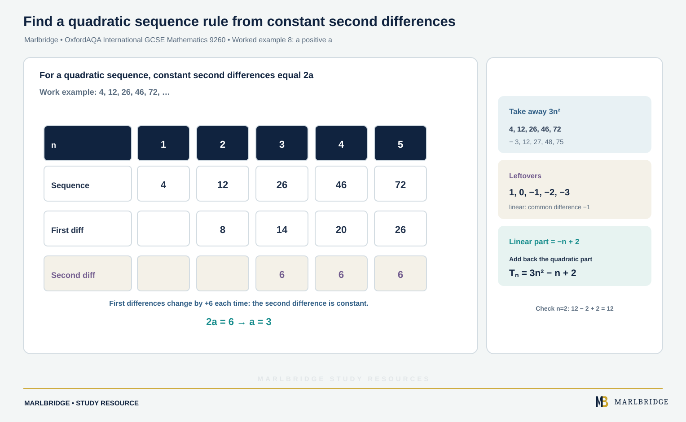

This study guide covers references A24, A25 and A26 in section 3.2.4 (Sequences) of the OxfordAQA International GCSE Mathematics (9260) specification, Version 5.1 (for exams May/June 2018 onwards). It teaches how to generate terms from a rule, how to recognise triangular, square and cube numbers, and how to find the nth term of a linear sequence. The specification says all content can be assessed on the Extension tier question papers, so Core content is also Extension content. Statements marked "Extension only" are the additional Extension content: quadratic sequences.

Use it with the [revision notes](/resources/oxfordaqa-igcse-mathematics-sequences-nth-terms-and-quadratic-sequences-revision-notes/) and the [practice questions](/resources/oxfordaqa-igcse-mathematics-sequences-nth-terms-and-quadratic-sequences-practice/). The course page is [OxfordAQA IGCSE Mathematics](/boards/oxfordaqa/igcse/mathematics/) and the printable list is the [checklist](/checklists/oxfordaqa/igcse/mathematics/). To find your weak spots first, try a [free 10-minute diagnostic](/diagnostics/). Substitution and rearranging are revised in [algebra notation and manipulation](/resources/igcse-oxfordaqa-mathematics-algebra-notation-and-manipulation/). Solving equations to test whether a number is a term is covered in [linear equations](/resources/oxfordaqa-igcse-mathematics-linear-equations-and-forming-equations-from-problems/) and [solving quadratics](/resources/oxfordaqa-igcse-mathematics-solving-quadratic-equations-by-factorising-completing/).

## What this guide covers

| Ref | What you must be able to do | Level |
|---|---|---|
| A24 | Produce terms using a term-to-term rule or a position-to-term rule | Core |
| A25 | Spot and use triangular, square and cube numbers and simple arithmetic progressions | Core |
| A25 | Spot and use quadratic sequences | Extension only |
| A26 | Deduce the nth term of a linear sequence | Core |
| A26 | Deduce the nth term of a quadratic sequence | Extension only |

## Terms, positions and rules (A24)

A **sequence** is a list of numbers in a set order. The numbers in it are its **terms**. A term's **position** says where it sits: position 1 is the first term, position 2 the second, and so on. The letter n stands for any position, so "the nth term" means whichever term is in place n.

There are two ways to describe a sequence with a rule.

- A **term-to-term rule** builds each term from the one before it, so you also need the starting term. Example: "start at 7, then double the previous term and subtract 3."
- A **position-to-term rule** gives the term directly from its position. You substitute the position number. Example: "the nth term is 3n − 2."

A term-to-term rule makes you build every term in between. A position-to-term rule jumps straight to the 50th term.

### Worked example 1: building terms one at a time

Start with 7. The rule is "multiply the previous term by 2, then subtract 3". Write down the first five terms.

```
Term 1 = 7
Term 2 = 2 × 7 − 3  = 11
Term 3 = 2 × 11 − 3 = 19
Term 4 = 2 × 19 − 3 = 35
Term 5 = 2 × 35 − 3 = 67
```

The terms are 7, 11, 19, 35, 67.

### Worked example 2: a position-to-term rule

The nth term of a sequence is 3n − 2. Find the first three terms, the 40th term, and the position of the first term greater than 100.

```
n = 1: 3(1) − 2 = 1
n = 2: 3(2) − 2 = 4
n = 3: 3(3) − 2 = 7
n = 40: 3(40) − 2 = 118
```

For the last part, solve the inequality 3n − 2 > 100. Then 3n > 102, so n > 34. The first whole number above 34 is 35. Check: the 34th term is 100, which is not greater than 100, and the 35th term is 103.

The first term greater than 100 is the 35th term, which is 103.

## Triangular, square and cube numbers (A25, Core)

You need to recognise these three families and know their nth terms.

| Family | First terms | nth term | How it grows |
|---|---|---|---|
| Triangular | 1, 3, 6, 10, 15, 21, 28, 36 | n(n + 1)/2 | add 2, then 3, then 4, ... |
| Square | 1, 4, 9, 16, 25, 36, 49, 64 | n² | add 3, then 5, then 7, ... |
| Cube | 1, 8, 27, 64, 125, 216, 343, 512 | n³ | no simple pattern of adding |

Triangular numbers count dots in a growing triangle with rows of 1, 2, 3, ... dots. Each new row is one longer, so the differences are 2, 3, 4, 5, ...

Some numbers belong to two families: 1 is in all three, 36 is square and triangular, and 64 is square and cube. Also, two consecutive triangular numbers add to a square number. For example 15 + 21 = 36 = 6².

### Worked example 3: testing for special numbers

(a) Is 276 a triangular number? (b) Is 1331 a cube number?

(a) If 276 = n(n + 1)/2 then n(n + 1) = 552. Look for two consecutive whole numbers with product 552. Since 23 × 24 = 552, the value n = 23 works. So 276 is the 23rd triangular number.

(b) Estimate: 10³ = 1000 and 12³ = 1728, so try 11. Then 11 × 11 = 121 and 121 × 11 = 1331. So 1331 is the cube of 11.

<figure class="topic-figure">
  
  <figcaption>Two consecutive triangular numbers add to a square number.</figcaption>
</figure>


## Arithmetic progressions and linear nth terms (A25 and A26, Core)

In an **arithmetic progression** every term differs from the previous one by a fixed step, called the **common difference**, d. It is positive for an increasing sequence and negative for a decreasing one. It is also called a linear sequence.

If the first term is a and the common difference is d, the nth term is

a + (n − 1)d, which simplifies to dn + (a − d).

So the number in front of n is always the common difference. The constant is "first term minus d".

### Method: find the nth term of a linear sequence

1. Work out the common difference d by subtracting a term from the next one. Check it is the same for every pair.
2. Write dn.
3. Compare dn with the actual terms. Find what must be added or subtracted: the constant is the first term minus d.
4. Write the nth term and test it on the first two terms.

### Worked example 4: an increasing sequence

Find the nth term of 8, 13, 18, 23, ... Is 148 a term? Is 200 a term?

The common difference is 5, so begin with 5n, which gives 5, 10, 15, 20. Every actual term is 3 bigger, so the nth term is **5n + 3**.

Check: n = 1 gives 8 and n = 2 gives 13.

For 148: solve 5n + 3 = 148. Then 5n = 145 and n = 29. Since 29 is a whole number, 148 sits in position 29.

For 200: solve 5n + 3 = 200. Then 5n = 197 and n = 39.4. A position must be a whole number, so 200 never appears.

### Worked example 5: a decreasing sequence

Find the nth term of 46, 40, 34, 28, ... and the first negative term.

The common difference is −6, so start with −6n. The terms of −6n are −6, −12, −18, −24. To reach 46 from −6 we add 52. The nth term is **52 − 6n**.

For the first negative term solve 52 − 6n < 0. Then 52 < 6n, so n > 8.67. The first whole number is 9, and the 9th term is 52 − 54 = −2.

### Worked example 6: from two terms

The 5th term of an arithmetic progression is 22 and the 9th term is 38. Find the nth term.

From the 5th term to the 9th term there are 4 steps, and the terms rise by 16. So 4d = 16 and d = 4. The nth term is 4n + c. Using the 5th term: 4(5) + c = 22, so c = 2.

The nth term is **4n + 2**. Check with the 9th term: 4(9) + 2 = 38.

### Worked example 7: a context

A stack of chairs is 84 cm tall with one chair. Each extra chair adds 7 cm. The ceiling is 250 cm above the floor. How many chairs can be stacked?

The heights are 84, 91, 98, ... so d = 7 and the height of n chairs is 7n + 77. Solve 7n + 77 ≤ 250. Then 7n ≤ 173 and n ≤ 24.7. Round down, because you cannot stack part of a chair: **24 chairs**, with height 7(24) + 77 = 245 cm.

<figure class="topic-figure">
  
  <figcaption>A constant difference d gives dn plus the value the line has at n = 0.</figcaption>
</figure>


## Quadratic sequences (A25 and A26, Extension only)

In a **quadratic sequence** the nth term looks like an² + bn + c, with a not zero. Here the first differences keep changing, but the **second differences** (differences between the first differences) stay fixed at **2a**. So a is half of that fixed value.

### Method: find the nth term of a quadratic sequence

1. Write the first differences, then the second differences. Check the second differences are all equal.
2. Halve the second difference to get a.
3. Take the terms of an² away from the matching terms of the sequence.
4. The leftovers form a linear sequence. Find its nth term, bn + c.
5. Write an² + bn + c and test it on the first two terms.

### Worked example 8: a positive a

<!-- marlbridge-diagram:math-b54-oxfordaqa-quadratic-sequence-second-differences -->
<figure class="lesson-diagram" style="margin: 2rem 0;">
  <a href="/public/images/learning/mathematics/math-b54-oxfordaqa-quadratic-sequence-second-differences.svg" aria-label="Open full-size diagram: math-b54-oxfordaqa-quadratic-sequence-second-differences"></a>
  <figcaption>A difference table for 4,12,26,46,72 shows first differences 8,14,20,26 and constant second differences 6. Halving gives a=3; subtracting 3n² leaves the linear sequence 1,0,−1,−2,−3, so Tₙ=3n²−n+2.</figcaption>
</figure>
<!-- /marlbridge-diagram:math-b54-oxfordaqa-quadratic-sequence-second-differences -->


Find the nth term of 4, 12, 26, 46, 72, ...

```
Sequence:        4    12    26    46    72
First diffs:        8     14    20    26
Second diffs:          6     6     6
```

The second difference is 6, so a = 3. The terms of 3n² are 3, 12, 27, 48, 75.

```
Sequence − 3n²:   1    0   −1   −2   −3
```

This is linear with difference −1, so it is −n + 2. The nth term is **3n² − n + 2**.

Check: n = 2 gives 12 − 2 + 2 = 12. Correct.

### Worked example 9: a negative a, and a fractional a

(a) Find the nth term of 10, 16, 20, 22, 22, ...
The first differences are 6, 4, 2, 0, and the second differences are all −2. So a = −1. The terms of −n² are −1, −4, −9, −16, −25. Subtracting them from the sequence leaves 11, 20, 29, 38, 47. This is 9n + 2. The nth term is **−n² + 9n + 2**.

(b) Find the nth term of 4, 9, 15, 22, 30, ...
The first differences are 5, 6, 7, 8, and the second differences are all 1. So a = 1/2. The terms of n²/2 are 0.5, 2, 4.5, 8, 12.5. Subtracting leaves 3.5, 7, 10.5, 14, 17.5, which is 3.5n. The nth term is **n²/2 + 7n/2**, which can be written n(n + 7)/2.

### Worked example 10: is a number a term?

The nth term of a sequence is 3n² − n + 2. Is 142 a term? Is 150 a term?

For 142: 3n² − n + 2 = 142, so 3n² − n − 140 = 0. Using the formula, the discriminant is 1 + 4(3)(140) = 1681 = 41². Then n = (1 ± 41)/6, giving n = 7 or n = −20/3. A position cannot be negative, so n = 7 and 142 is the 7th term. Check: 3(49) − 7 + 2 = 142.

For 150: 3n² − n − 148 = 0 has discriminant 1 + 4(3)(148) = 1777. It is not a perfect square, so n cannot be a whole number and 150 is not in the sequence.

<figure class="topic-figure">
  
  <figcaption>Worked example 8: second difference 6 gives a = 3, and what is left over is linear.</figcaption>
</figure>

<figure class="topic-figure">
  
  <figcaption>Halve the second difference even when it is negative or odd.</figcaption>
</figure>

<figure class="topic-figure">
  
  <figcaption>A value is a term only if the line meets the curve at a whole-number position.</figcaption>
</figure>

<figure class="topic-figure">
  
  <figcaption>A constant second difference means a quadratic nth term.</figcaption>
</figure>

<figure class="topic-figure">
  
  <figcaption>Keep taking differences until a row is constant; that row tells you the type.</figcaption>
</figure>


## Common errors

- Starting a linear nth term with the first term instead of the common difference. For 8, 13, 18 the nth term is 5n + 3, not 8n + 5.
- Getting the sign wrong on a decreasing sequence: 46, 40, 34 is 52 − 6n, not 6n + 52.
- Using the second difference as a instead of halving it.
- Subtracting the n² terms from the wrong sequence, or adding when a is negative.
- Forgetting to test the formula on the first two terms.
- Claiming a number is a term when n is not a whole number, or when n is negative.
- Calling a sequence quadratic after finding only one second difference. Check that they are all equal.

## Next steps

Use the revision notes for a condensed version, then try the practice questions, and tick off what you have covered on the checklist.

## Frequently asked questions

**What is an arithmetic progression?**
An arithmetic progression is a sequence where every term differs from the previous one by a fixed step, the common difference d. It is also called a linear sequence.

**How do you find the nth term of a quadratic sequence?**
Find the second difference and halve it to get a. Subtract an² from each term, find the nth term bn + c of the linear remainder, and write an² + bn + c, testing it on the first two terms.

**What is the nth term of 46, 40, 34?**
It is 52 − 6n, because the common difference is −6 and 46 − (−6) = 52. Writing 6n + 52 is a common sign error.

**Which sequences topics are Extension only in OxfordAQA 9260?**
In OxfordAQA International GCSE Mathematics (9260), generating terms, special number families, arithmetic progressions and linear nth terms are Core. Spotting and finding the nth term of quadratic sequences (A25 and A26) are Extension only.

## Official syllabus

OxfordAQA International GCSE Mathematics (9260), Version 5.1, for exams May/June 2018 onwards, published by OxfordAQA. Section 3.2.4, references A24, A25 and A26.
